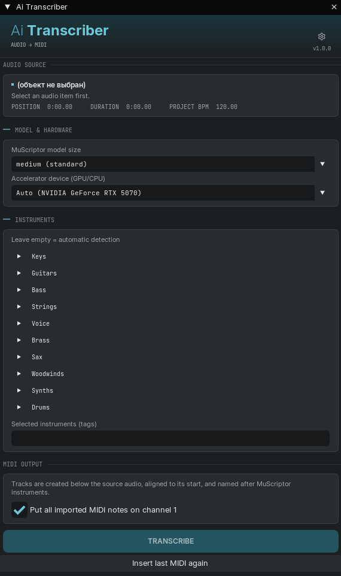
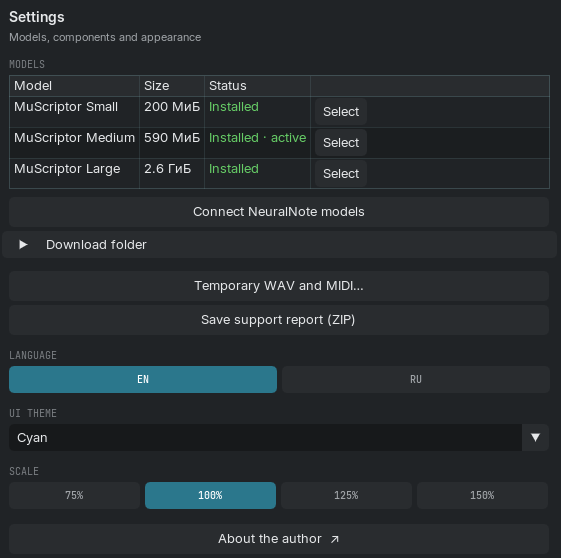

# Ai Transcriber

**Turn audio into MIDI without leaving REAPER.** Select a recording, choose the
instruments and press **Transcribe**. The MIDI appears below the source, ready to
edit and play with your virtual instruments.

**Windows x64 · Local processing · Vulkan GPU or CPU · Version 1.0.2**

Русская версия: [README.ru.md](README.ru.md)

<table>
  <tr><th>Audio to MIDI</th><th>Models and settings</th></tr>
  <tr>
    <td valign="top"></td>
    <td valign="top"></td>
  </tr>
</table>

*Main window and Settings in Ai Transcriber, with the English interface.*

## How it works

You select audio in the REAPER project, choose the model and the instruments, then
press Transcribe. The script prepares the audio, runs recognition and places MIDI on
tracks under the source. The result starts exactly at the source item; tracks are
named after the recognized instruments.

Recognition is done by the **MuScriptor** neural network through the
[muscriptor.cpp](https://github.com/DamRsn/muscriptor.cpp) C++ engine. Everything
runs locally on your computer. Internet is needed to install components and
download models.

## Features

- **Audio to MIDI straight from the REAPER project.** No separate export and no
  manual import of the result.
- **Several selected fragments at once.** Sliced and rearranged fragments of one
  track are processed as a single part, keeping their positions and the pauses
  between them.
- **Three MuScriptor models: Small, Medium and Large.** Settings show the state of
  each model and install buttons; the main window lists the installed models.
- **Instrument selection.** Piano, guitar, bass, strings, vocals, winds, synths,
  drums and other groups. Leave the list empty for automatic detection.
- **Per-track instrument memory.** Returning to a track restores its choice; a new
  track starts empty. The choice is saved separately for each project.
- **Compute device selection.** Automatic mode, CPU, or GPUs discovered by the
  engine via Vulkan.
- **MIDI split by instrument.** The result is placed on separate tracks; if needed,
  everything can be merged to MIDI channel 1.
- **Re-insert the last MIDI.** A saved result can be inserted again without running
  recognition.
- **Model downloads in Settings.** Several models can download in parallel, each
  with its own progress and a stop button.
- **Temporary WAV and MIDI cleanup.** A list of matching files is shown before
  deleting; running jobs and components are protected.
- **Error diagnostics.** Codes, explanations and available actions. Copy a TXT log
  or save a ZIP report for support; the folder opens after saving and nothing is
  sent automatically.
- **Interface.** Russian and English, three themes (Amber, Light, Cyan), scale
  75%, 100%, 125% and 150%.

## Installation (ReaPack)

You can install through ReaPack or use the ordinary ZIP installer described below.

ReaPack installs the Lua script, fonts, license texts and the native engine.
Use *Synchronize packages* to check for updates. No BAT installer is needed.

1. Install [ReaPack](https://reapack.com) if you don't have it.
2. In REAPER open *Extensions → ReaPack → Import repositories…*
3. Paste the Aiwist scripts index URL. It is the single address for every
   Aiwist script; new ones appear there automatically:
   ```
   https://github.com/Aiwist/ai-scripts/raw/main/index.xml
   ```
4. Press *OK*, then *Extensions → ReaPack → Browse packages*, find
   **Ai Transcriber** and install the package.
5. If **ReaImGui** is not installed yet, get it from the *ReaTeam Extensions*
   repository.
6. Run **Ai Transcriber** from Actions. Read and accept the bundled terms on first
   launch, then download a model in Settings.

The package uses `Scripts/Aiwist/Transcriber/Aiwist_Transcriber.lua`, the same action
path as the BAT installation. Close Ai Transcriber and finish running jobs before
updating. ReaPack may ask to replace files from a previous manual installation;
check that the path is the same. Preferences and model paths are kept.

Models stay outside ReaPack in `%LOCALAPPDATA%\Ai Transcriber\models` by default.
Removing the ReaPack package does not delete these models or your preferences.

## Installation (ZIP)

1. Download **Ai_Transcriber_Setup_1.0.2_Windows.zip** from
   [GitHub Releases](https://github.com/Aiwist/ai-transcriber/releases).
2. Extract the entire archive into a folder and run **Установить.bat**.
3. Read the terms, check the REAPER resource folder and click **Install / update**.
   The installer downloads ReaImGui from its author's GitHub if needed and adds
   Ai Transcriber to Actions. Restart REAPER if prompted.
4. Run Ai Transcriber, accept the first-run terms and install a model in Settings.

Choose the prepared installer ZIP, not GitHub's automatic **Source code** archive:
the source archive does not include the engine executable. Both installation
methods use the same action path, preferences and model files.

| Model | Approximate download |
|---|---:|
| MuScriptor Small | 200 MiB |
| MuScriptor Medium | 590 MiB |
| MuScriptor Large | 2.6 GiB |

These are model file sizes, not GPU memory requirements.

## Requirements

Windows x64, REAPER, and ReaImGui 0.10 or newer. ReaPack and ReaImGui are separate
extensions: installing ReaPack alone does not install ReaImGui. Ai Transcriber
checks for it and can open its package in ReaPack. The ZIP installer can install
it automatically; installation through ReaPack keeps it as a separate package.

Both the ReaPack package and the ZIP install the same CPU and Vulkan executables.
CPU mode uses the CPU build; automatic mode and a selected GPU use the Vulkan
build. Python and CUDA Toolkit are not required. GPU execution needs a compatible
Vulkan driver.

## Author and components

Author — **Aiwist**. The code was developed with **OpenAI Codex**.

The original Lua code is distributed under the Apache License 2.0. Attribution is
in [NOTICE.txt](Transcriber/NOTICE.txt), license texts are in the
[licenses folder](Transcriber/licenses). Third-party engines, libraries and models
keep their own terms; they are listed in
[THIRD_PARTY_NOTICES_RU.txt](Transcriber/THIRD_PARTY_NOTICES_RU.txt).
