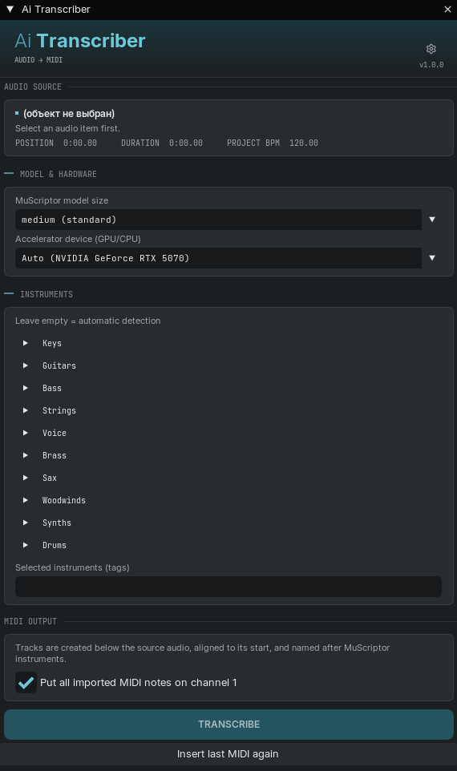
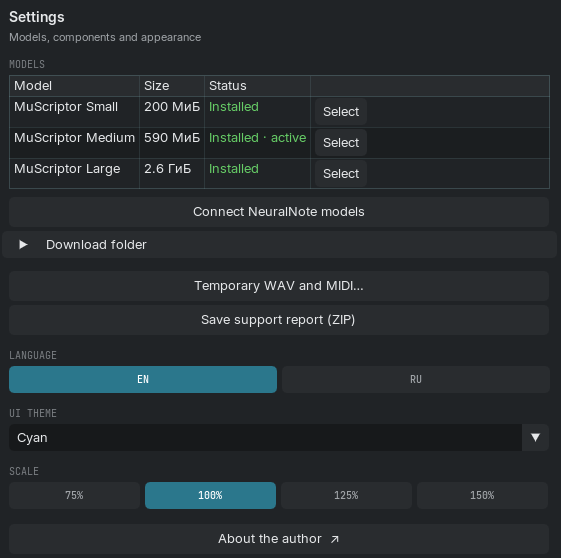

# Ai Transcriber

**Перевод аудио в MIDI прямо в REAPER.** Выделите запись, выберите инструменты
и нажмите **«Транскрибировать»**. MIDI появится на дорожках под исходным аудио:
ноты можно редактировать и воспроизводить виртуальными инструментами.

**Windows x64 · Локальная обработка · Vulkan GPU или CPU · Версия 1.0.2**

English version: [README.md](README.md)

<table>
  <tr><th>Транскрибация аудио</th><th>Модели и настройки</th></tr>
  <tr>
    <td valign="top"></td>
    <td valign="top"></td>
  </tr>
</table>

*Основное окно и настройки Ai Transcriber с английским интерфейсом.*

## Как это работает

Пользователь выделяет аудио в проекте REAPER, выбирает модель и нужные инструменты,
затем нажимает «Транскрибировать». Скрипт подготавливает звук, запускает распознавание
и размещает MIDI на дорожках под исходным аудио. Начало результата совмещается
с исходником; дорожки получают названия распознанных инструментов.

Распознавание выполняет нейросеть **MuScriptor** через C++-движок
[muscriptor.cpp](https://github.com/DamRsn/muscriptor.cpp). Вычисления происходят
локально на компьютере. Интернет нужен для установки компонентов и скачивания моделей.

## Функции

- **Транскрибация аудио в MIDI прямо из проекта REAPER.** Не нужно отдельно
  экспортировать исходник и вручную импортировать результат.
- **Обработка нескольких выбранных фрагментов.** Нарезанные и переставленные
  фрагменты одной дорожки можно отправить как одну партию с сохранением их
  положения и пауз между ними.
- **Три модели MuScriptor: Small, Medium и Large.** В настройках видны состояние
  каждой модели и кнопки установки. В основном окне доступны установленные модели.
- **Выбор инструментов.** Можно указать фортепиано, гитару, бас, струнные, вокал,
  духовые, синтезаторы, барабаны и другие доступные группы. Пустой список включает
  автоматическое определение инструментов.
- **Запоминание инструментов для дорожек.** При возвращении к дорожке
  восстанавливается её выбор; на новой дорожке список начинается пустым.
  Выбор сохраняется отдельно для каждого проекта.
- **Выбор устройства вычислений.** Доступны автоматический режим, CPU и
  видеокарты, обнаруженные движком через Vulkan.
- **Вывод MIDI по инструментам.** Результат размещается на отдельных дорожках.
  При необходимости все импортированные ноты можно свести на MIDI-канал 1.
- **Повторная вставка последнего MIDI.** Сохранённый результат можно вставить
  снова без повторного распознавания аудио.
- **Загрузка моделей из настроек.** Несколько моделей могут скачиваться
  параллельно, с отдельным прогрессом и остановкой каждой загрузки.
- **Управление временными WAV и MIDI.** Перед очисткой показывается список
  подходящих файлов. Работающие задания и компоненты защищены от удаления.
- **Диагностика ошибок.** Отображаются коды, пояснения и доступные действия.
  Можно скопировать журнал TXT или сохранить ZIP-отчёт для поддержки.
  После сохранения ZIP открывается его папка; автоматической отправки нет.
- **Настройка интерфейса.** Русский и английский языки, темы «Янтарь», «Светлая»
  и «Циан», масштаб 75%, 100%, 125% и 150%.

## Установка через ReaPack

ReaPack устанавливает Lua-скрипт, шрифты, лицензии и нативный движок.
Обновления проверяются командой *Synchronize packages*. BAT для этого не нужен.

1. Установите [ReaPack](https://reapack.com), если его ещё нет.
2. В REAPER откройте *Extensions → ReaPack → Import repositories…*
3. Вставьте ссылку на общий индекс скриптов Aiwist — этот адрес один для всех
   его скриптов, новые появятся в нём автоматически:
   ```
   https://github.com/Aiwist/ai-scripts/raw/main/index.xml
   ```
4. Нажмите *OK*, затем *Extensions → ReaPack → Browse packages*, найдите
   **Ai Transcriber** и установите пакет.
5. Если ещё не установлен **ReaImGui**, поставьте его из репозитория
   *ReaTeam Extensions*.
6. Запустите **Ai Transcriber** из Actions. При первом запуске ознакомьтесь
   с условиями и примите их, затем установите модель в настройках.

Путь остаётся прежним: `Scripts/Aiwist/Transcriber/Aiwist_Transcriber.lua`.
Перед обновлением завершите задания и закройте окно скрипта. При переходе
с ручной установки ReaPack может предложить заменить существующие файлы:
проверьте, что речь об этой папке. Настройки и пути моделей сохраняются.

Модели по умолчанию находятся в `%LOCALAPPDATA%\Ai Transcriber\models`, отдельно
от пакета. Удаление пакета через ReaPack не удаляет модели и настройки.

## Установка через ZIP

1. Скачайте **Ai_Transcriber_Setup_1.0.2_Windows.zip** со
   [страницы релизов](https://github.com/Aiwist/ai-transcriber/releases).
2. Полностью распакуйте архив в папку и запустите **Установить.bat**.
3. Ознакомьтесь с условиями, проверьте путь к ресурсной папке REAPER и нажмите
   **«Установить / обновить»**. При необходимости установщик скачает ReaImGui
   с GitHub его автора и добавит Ai Transcriber в Actions.
   Если потребуется перезапуск REAPER, установщик сообщит об этом.
4. Запустите скрипт, примите условия первого запуска и установите модель
   в настройках.
5. Выделите аудио, выберите инструменты и нажмите **«Транскрибировать»**.

Выбирайте готовый установочный ZIP. Автоматический архив **Source code** на GitHub
не содержит исполняемого файла движка.

| Модель | Примерный объём скачивания |
|---|---:|
| MuScriptor Small | 200 МиБ |
| MuScriptor Medium | 590 МиБ |
| MuScriptor Large | 2,6 ГиБ |

Это размеры файлов моделей, а не требования к видеопамяти.

Для интерфейса используется расширение **ReaImGui**. Нативный движок входит
в готовый установочный комплект; модели загружаются отдельно. Новые модели
по умолчанию сохраняются вместе в `%LOCALAPPDATA%\Ai Transcriber\models`.

В версии **1.0.2** оба способа устанавливают одинаковые сборки CPU и Vulkan.
Режим «Только CPU» запускает CPU-сборку; «Авто» и выбор видеокарты — Vulkan-сборку.
Python и CUDA Toolkit не требуются. Для видеокарты нужен совместимый драйвер Vulkan.

ReaPack и ReaImGui — отдельные расширения. Наличие ReaPack не означает, что
ReaImGui уже установлен. Нужна версия ReaImGui 0.10 или новее: скрипт проверяет
её и предлагает открыть нужный пакет. В ZIP-установщике есть автоматическая
установка ReaImGui; при установке через ReaPack расширение выбирается отдельно.

## Авторство и компоненты

Автор проекта — **Aiwist**.
Код разрабатывался с помощью **OpenAI Codex**.

Оригинальный Lua-код автора распространяется по Apache License 2.0.
Сведения об авторстве находятся в [NOTICE.txt](Transcriber/NOTICE.txt),
а тексты лицензий — в [папке licenses](Transcriber/licenses).
Сторонние движки, библиотеки и модели сохраняют собственные условия;
они перечислены в [THIRD_PARTY_NOTICES_RU.txt](Transcriber/THIRD_PARTY_NOTICES_RU.txt).
